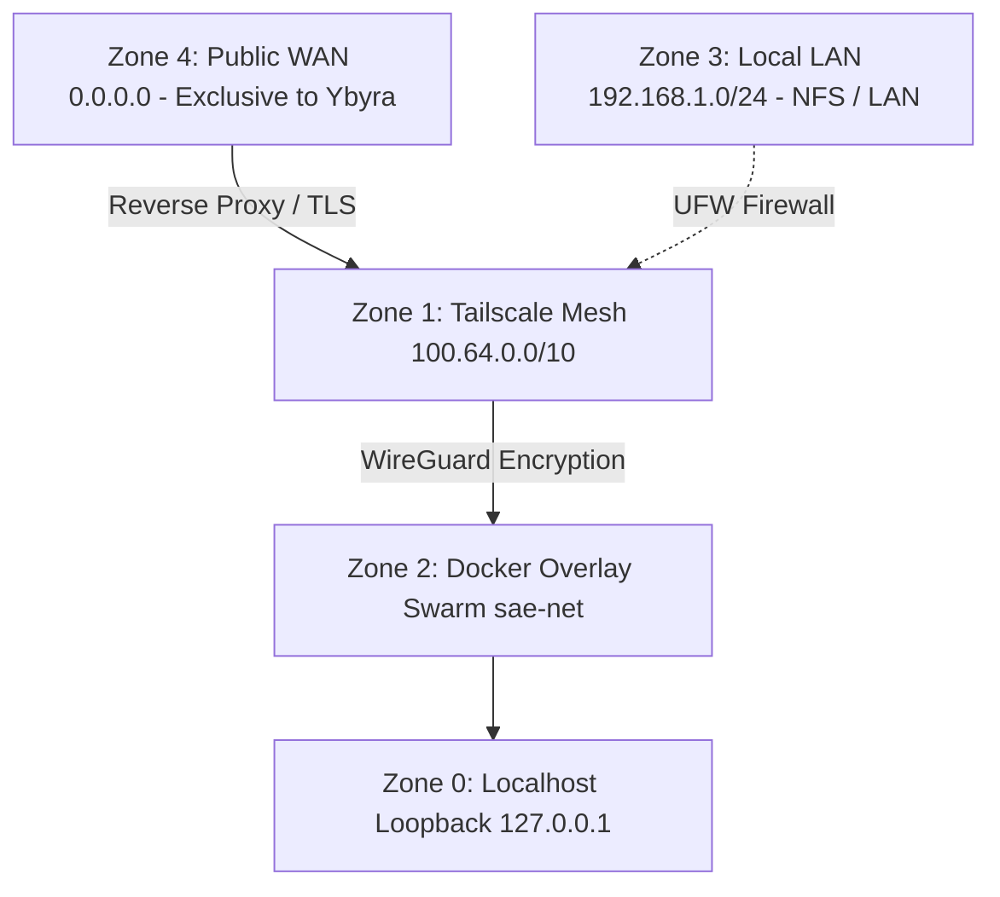

# Canonical Port Catalog & Attack Surface Matrix (Mnemocine Homelab)

> **Status:** Canonical reference audited by Stenio Sentinel (`stenio --ports`)  
> **Security Philosophy:** Zero Trust & Defense in Depth. Every open listening port MUST possess an explicit technical rationale, a restricted binding interface, and a direct link to documentation.

---

## 1. Trust Zones & Binding Policies

The homelab enforces strict network tier segregation. No service may listen outside its designated trust zone:

| Zone | Interface / Subnet | Permitted Exposure | Authorized Services |
|---|---|---|---|
| **Zone 0: Loopback** | `127.0.0.1`, `::1` | Isolated to local host | Docker Daemon (`2375`), IPC sockets, temporary development |
| **Zone 1: Tailnet** | `100.64.0.0/10` (`tailscale0`) | Private encrypted mesh (WireGuard) | **Mandatory default channel** for 95% of homelab services |
| **Zone 2: Swarm Overlay** | `sae-net` | Microservices and GPU worker nodes | Inter-container routing (API ↔ Valkey ↔ StênioREC) |
| **Zone 3: Local LAN** | `192.168.1.0/24` / `192.168.3.0/24` | Restricted to home physical Ethernet / Wi-Fi | NFSv4 (`2049`), Syncthing discovery (`22000`), KDE Connect (`1716`) |
| **Zone 4: Public WAN** | `0.0.0.0` (Open Internet) | **STRICTLY RESTRICTED** | Ports 80/443 on edge gateway node `ybyra` exclusively |

> [!CAUTION]
> **Prohibition of `0.0.0.0` on internal nodes:** Binding internal services (databases, inference APIs, or management dashboards) to `0.0.0.0` is strictly forbidden. If an internal service requires multi-node access, bind explicitly to its Tailscale IP (`100.x.y.z`) or the `tailscale0` interface.

---

## 2. Canonical Port Matrix by Node

> **Reality audit (HB-039, 2026-10-12):** the *Bind Interface* column now records the **observed live bind** (`ss -tlnp` on each node + the compose manifests mirrored under `/mnt/BACKUP/configs-homelab`), not the previously-aspirational value. A row marked **⚠️ defect** is a `0.0.0.0` socket that is **not** firewall-scoped and therefore violates §1 — it must be re-bound to the host's Tailnet IP (`100.x.y.z`) or loopback (tracked by HB-039). Accepted `0.0.0.0` binds are listed in §4.

### 2.1. Psicopompo (`100.82.51.112`) — Workstation, GPU Worker & Tailnet NAS

| Port / Proto | Bind Interface | Service | Technical Justification | Canonical Reference |
|---|---|---|---|---|
| `9090/tcp` | `127.0.0.1` + `100.82.51.112` | **`steniorec`** (Axum/Whisper) | GPU-accelerated audio transcription and streaming STT | [`../services/steniorec.md`](../services/steniorec.md) |
| `9095/tcp` | `127.0.0.1` + `100.82.51.112` (+ docker subnets via scoped ufw) | **`hl-infer`** | Centralized GPU inference gateway (dynamic VRAM ledger, admission queue, fixed windows) | [`../services/hl-infer.md`](../services/hl-infer.md) |
| `8188/tcp` | `127.0.0.1` + `100.82.51.112` | **ComfyUI** | Diffusion image generation (GPU `image_gen` consumer; idles at ~84 MiB, generations run under a lease) | [`../services/comfyui.md`](../services/comfyui.md) |
| `53/tcp,udp` | `192.168.122.1` (`virbr0`) | **libvirt dnsmasq** | DNS + DHCP for the isolated libvirt NAT network (guest VM `kali-linux`); reachable only on the host-internal `virbr0` bridge, never on LAN/tailnet | [`../servers/psicopompo.md`](../servers/psicopompo.md) |
| `9777/udp` | `0.0.0.0` (ufw-scoped — see §4) | **Punktfunk Native** | QUIC control & streaming for LAN/tailnet clients | [`../services/punktfunk.md`](../services/punktfunk.md) |
| `47990/tcp` | `0.0.0.0` (ufw-scoped — see §4) | **Punktfunk Management API** | HTTPS management API (mTLS/bearer auth) | [`../services/punktfunk.md`](../services/punktfunk.md) |
| `47992,47993/tcp` | `0.0.0.0` (ufw-scoped — see §4) | **Punktfunk Web Console** | Authentication-gated admin console + plugin interface bindings | [`../services/punktfunk.md`](../services/punktfunk.md) |
| `11470,12470/tcp` | `0.0.0.0` | **Stremio local server** | Embedded Node streaming/transcoding server of the Stremio desktop client (fixed ports 11470 + 12470). **⚠️ defect** — a desktop app must bind `127.0.0.1`; UFW default-deny currently masks the exposure | [`../services/stremio/stremio-manifest.md`](../services/stremio/stremio-manifest.md) |
| `8384/tcp` | `127.0.0.1` + `100.82.51.112` | **Syncthing Web** | Web administration UI for vault synchronization | [`../backups/`](../backups/) |
| `22000/tcp,udp` | LAN + `tailscale0` | **Syncthing Protocol** | Mutual TLS encrypted synchronization transport | [`../backups/`](../backups/) |
| `2049/tcp` | `100.82.51.112` / `tailscale0` | **NFSv4 Server** | Encrypted shared NAS storage for `/mnt/BACKUP` (WireGuard) | [`nfs.md`](nfs.md) |
| `111/tcp,udp` | LAN (`0.0.0.0`, ufw-scoped to tailnet) | **rpcbind** | RPC port mapping daemon for legacy NFS operations | [`nfs.md`](nfs.md) |
| `20048/tcp,udp` | LAN (`0.0.0.0`) | **rpc.mountd** | NFS mount request daemon | [`nfs.md`](nfs.md) |
| `61208/tcp` | `127.0.0.1` + `100.82.51.112` | **Glances** | System telemetry (CPU, RAM, GPU, thermal metrics) | [`service-topology.md`](service-topology.md) |
| `9100/tcp` | `100.82.51.112` / `tailscale0` | **Node Exporter** | Prometheus host performance exporter | [`../services/`](../services/) |
| `9080/tcp` | `127.0.0.1` (Localhost) | **Promtail** | Loki log shipping agent (HTTP health endpoint) | [`../services/`](../services/) |
| `9096/tcp` | `127.0.0.1` + `tailscale serve` | **hl-wol-relay** | Wake-on-LAN daemon target to wake **kavure**; bound to loopback | [`../services/wol-relay.md`](../services/wol-relay.md) |
| `9092/tcp` | `0.0.0.0` (Swarm Ingress) | **Swarm Ingress Mesh** | Multi-host dynamic ingress load balancing | [`../services/`](../services/) |
| `7946/tcp,udp` | `0.0.0.0` (ufw-scoped to `tailscale0` — see §4) | **Docker Swarm Gossip** | Distributed control plane clustering heartbeat | [`../services/`](../services/) |
| `4789/udp` | `0.0.0.0` (ufw-scoped to `tailscale0` — see §4) | **Docker VXLAN Overlay** | Encapsulated overlay network packet routing | [`../services/`](../services/) |
| `2375/tcp` | `127.0.0.1` + `100.82.51.112` | **docker-socket-proxy** | Hardened read-only Docker socket proxy for Homepage | [`service-topology.md`](service-topology.md) |
| `5000/tcp` | `127.0.0.1` + `100.82.51.112` / `tailscale0` | **registry** | Homelab Docker image registry (TLS + htpasswd). Single source for Swarm images | [`../guides/docker-registry.md`](../guides/docker-registry.md) |
| `1716/tcp,udp` | LAN (Local Wi-Fi) | **KDE Connect** | Mobile device integration and clipboard syncing | Desktop use |

---

### 2.2. Kavure (`100.124.146.77`) — Swarm Manager & Core Services Node

| Port / Proto | Bind Interface | Service | Technical Justification | Canonical Reference |
|---|---|---|---|---|
| `9090/tcp` | `sae-net` (Overlay — unexposed on host) | **sae-core_api** | Sumænimá Hub Core REST & WebSocket API. Reached via edge reverse proxy (`/api/health` → 200). Note: `9090` on **psicopompo** hosts `steniorec` | [`../services/steniobot.md`](../services/steniobot.md) |
| `5432/tcp` | `sae-net` (Overlay — unexposed on host) | **PostgreSQL (sae-core_db)** | Relational database backend for Hub and core services | [`../services/`](../services/) |
| `6379/tcp` | `sae-net` (Overlay — unexposed on host) | **Valkey (sae-core_valkey)** | High-throughput in-memory cache and Pub/Sub message broker | [`../services/steniobot.md`](../services/steniobot.md) |
| `2377/tcp` | `0.0.0.0` (UFW-scoped to `tailscale0` — see §4) | **Swarm Manager** | Docker Swarm raft consensus; dockerd binds all interfaces by design (no per-interface bind). **UFW active since 2026-10-13** (HB-047) → LAN blocked, tailnet-only | [`../services/`](../services/) |
| `7946/tcp,udp` | `0.0.0.0` (UFW-scoped to `tailscale0` — see §4) | **Swarm Gossip** | Node discovery and health gossip across Swarm nodes; inherent `0.0.0.0`. **UFW active since 2026-10-13** (HB-047) → LAN blocked, tailnet-only | [`../services/`](../services/) |
| `4789/udp` | `0.0.0.0` (UFW-scoped to `tailscale0` — see §4) | **Swarm VXLAN** | Inter-container overlay packet transport; inherent `0.0.0.0`. **UFW active since 2026-10-13** (HB-047) → LAN blocked, tailnet-only | [`../services/`](../services/) |
| `9092/tcp` | `0.0.0.0` (Swarm Ingress; UFW-scoped to `tailscale0`) | **backup-sentinel & Ingress** | Backup integrity healthcheck and cluster ingress routing endpoint. **UFW active since 2026-10-13** (HB-047) → LAN blocked, tailnet-only | [`../services/`](../services/) |
| `9100/tcp` | `0.0.0.0` | **Node Exporter** | Host OS performance metrics exporter. **⚠️ defect** (bind) — container runs `network_mode: host` with no `--web.listen-address`; **UFW active since 2026-10-13** (HB-047) → LAN blocked, tailnet-only | [`../services/`](../services/) |
| `61208/tcp` | `100.124.146.77` / `tailscale0` | **Glances** | Host hardware resource telemetry | [`service-topology.md`](service-topology.md) |
| `2375/tcp` | `127.0.0.1` + `100.124.146.77` / `tailscale0` | **docker-socket-proxy** | Restricted Docker API socket queried by Homepage | [`../services/homepage.md`](../services/homepage.md) |
| `3000/tcp` | `127.0.0.1` + `100.124.146.77` / `tailscale0` | **AioStreams** | Stream aggregation server (tailnet + public Funnel :10000) | [`../services/aiostreams.md`](../services/aiostreams.md) |
| `3001/tcp` | `100.124.146.77` / `tailscale0` | **Zomboid Control Panel** | Web administrative interface for Project Zomboid dedicated server | [`../servers/kavure.md`](../servers/kavure.md) |
| `3002/tcp` | `100.124.146.77` / `tailscale0` | **Grafana** | Central telemetry dashboard and metrics visualization | [`../services/`](../services/) |
| `3100/tcp` | `100.124.146.77` / `tailscale0` | **Loki** | Distributed log aggregation and storage daemon | [`../services/`](../services/) |
| `4533/tcp` | `100.124.146.77` / `tailscale0` | **Navidrome** | Subsonic-compatible personal music streaming service | [`../servers/kavure.md`](../servers/kavure.md) |
| `5678/tcp` | `100.124.146.77` / `tailscale0` | **n8n (Homelab)** | Standalone Homelab workflow engine (reactivated 2026-10-09; tailnet-only bind) | [`../services/n8n.md`](../services/n8n.md) |
| `8000/tcp` | `100.124.146.77` / `tailscale0` | **Comet** | Stremio torrent indexing and metadata addon | [`../services/comet.md`](../services/comet.md) |
| `8080/tcp` | `100.124.146.77` / `tailscale0` | **SearXNG Core** | Self-hosted privacy-preserving metasearch engine | [`../servers/kavure.md`](../servers/kavure.md) |
| `8083/tcp` | `100.124.146.77` / `tailscale0` | **Calibre Web** | eBook collection catalog and reader | [`../services/calibre-web.md`](../services/calibre-web.md) |
| `8123/tcp` | `0.0.0.0` (host networking — see §4) | **Home Assistant** | Home automation core and IoT sensor orchestration. **UFW active since 2026-10-13** (HB-047) → LAN blocked, tailnet-only (the §3.1 mDNS/SSDP discovery stays) | [`../services/home-assistant.md`](../services/home-assistant.md) |
| `18554/tcp` | `127.0.0.1` | **go2rtc (embedded)** | Home Assistant embedded go2rtc WebRTC server (cameras not yet configured) | [`../services/home-assistant.md`](../services/home-assistant.md) |
| `18555/tcp` | `0.0.0.0` | **go2rtc API** | Home Assistant embedded go2rtc HTTP/API endpoint. **⚠️ defect** (bind) — should bind tailnet; **UFW active since 2026-10-13** (HB-047) → LAN blocked, tailnet-only | [`../services/home-assistant.md`](../services/home-assistant.md) |
| `8444/tcp` | `100.124.146.77` / `tailscale0` | **Crafty Controller** | Web management panel for dedicated Minecraft server | [`../services/crafty.md`](../services/crafty.md) |
| `9091/tcp` | `100.124.146.77` / `tailscale0` | **Prometheus** | Time-series metrics storage and monitoring daemon | [`../services/`](../services/) |
| `9093/tcp` | `100.124.146.77` / `tailscale0` | **Alertmanager** | Alert routing and notification engine | [`../services/`](../services/) |
| `53/tcp,udp` | `127.0.0.1` + `100.124.146.77` / `tailscale0` | **Pi-hole** | Filtering DNS — second peer in the parallel Tailscale race (migrated from kuaray; host networking, `FTLCONF_dns_interface=tailscale0`) | [`dns.md`](dns.md) |
| `80/tcp` | `0.0.0.0` | **Pi-hole Web UI (HTTP)** | Pi-hole v6 CivetWeb admin console (`webserver.port=80o`). **⚠️ defect** (bind) — admin UI bound on all interfaces; **UFW active since 2026-10-13** (HB-047) → LAN blocked, tailnet-only | [`../services/pihole.md`](../services/pihole.md) |
| `443/tcp` | `0.0.0.0` | **Pi-hole Web UI (HTTPS)** | Pi-hole v6 CivetWeb TLS admin console (`webserver.port=443os`). **⚠️ defect** (bind); **UFW active since 2026-10-13** (HB-047) → LAN blocked, tailnet-only | [`../services/pihole.md`](../services/pihole.md) |
| `5053/tcp` | `127.0.0.1` + `100.124.146.77` | **unbound** | Native recursive DNSSEC resolver (upstream for Pi-hole + AdGuard) | [`../services/unbound.md`](../services/unbound.md) |
| `9097/tcp` | `0.0.0.0` | **hl-unbound-status** | Native Rust HTTP health endpoint for the Homepage unbound tile. **⚠️ defect** (bind) — should bind tailnet; **UFW active since 2026-10-13** (HB-047) → LAN blocked, tailnet-only | [`../services/unbound.md`](../services/unbound.md) |
| `9095/tcp` | `0.0.0.0` | **hl-minecraft-status** | Native Rust HTTP status endpoint for the Homepage Minecraft tile. **⚠️ defect** (bind) — should bind tailnet; **UFW active since 2026-10-13** (HB-047) → LAN blocked, tailnet-only | [`../services/minecraft-status.md`](../services/minecraft-status.md) |
| `10000/tcp` | `100.124.146.77` / `tailscale0` | **Tailscale Funnel ingress** | Public TLS Funnel fronting AioStreams/HA on kavure | [`tailscale.md`](tailscale.md) |
| `111/tcp,udp` | `0.0.0.0` | **rpcbind** | RPC port mapper for NFS client mounts. **⚠️ defect** (bind) — `0.0.0.0` bind; **UFW active since 2026-10-13** (HB-047) → LAN blocked, tailnet-only | [`nfs.md`](nfs.md) |
| `9096/tcp` | `127.0.0.1` + `tailscale serve` | **hl-wol-relay** | Wake-on-LAN relay target to wake **psicopompo** | [`../services/wol-relay.md`](../services/wol-relay.md) |
| `25565/tcp` | `tailscale0` (was LAN + `tailscale0`) | **Minecraft Dominium** | Dedicated Minecraft server game port. **UFW active since 2026-10-13** (HB-047) → LAN blocked, tailnet-only (owner decision: no LAN players — reached by tailnet shared users only) | [`../services/crafty.md`](../services/crafty.md) |
| `40000/udp` | `0.0.0.0`, `[::]` (`tailscaled`) | **Tailscale Peer Relay** | High-throughput direct peer-to-peer WireGuard relay | [`tailscale.md`](tailscale.md) |

> **Correction (2026-10-13):** the row **`8766/tcp` — `sae-core_asciline`** was removed. The service
> does **not exist**: the `sae-core` stack has exactly `api`, `db`, `valkey`, `umami-db` and `backup`
> (`docker service ls` on kavure). No `asciline` container, image or published port is present on any
> node. The claim had propagated into this matrix and §4 from an earlier draft of the Hub stack.

---

### 2.3. Ybyra (`100.66.224.34`) — Cloud Primary Edge & DMZ Gateway

| Port / Proto | Bind Interface | Service | Technical Justification | Canonical Reference |
|---|---|---|---|---|
| `80/tcp` | `0.0.0.0` (Public WAN — see §4) | **Nginx Reverse Proxy** | Public HTTP listener (permanent redirect to HTTPS) | [`topology.md`](topology.md) |
| `443/tcp` | `0.0.0.0` (Public WAN — see §4) | **Nginx Reverse Proxy** | TLS termination (Certbot / Let's Encrypt) and reverse proxy routing | [`topology.md`](topology.md) |
| `2375/tcp` | `100.66.224.34` / `tailscale0` | **docker-socket-proxy** | Edge Docker metrics collector for Homepage over Tailnet | [`../services/homepage.md`](../services/homepage.md) |
| `9100/tcp` | `0.0.0.0` (host nftables → tailnet only — see §4) | **Node Exporter** | Edge host OS metrics scraped by Prometheus (host firewall rejects non-tailnet inbound) | [`../services/`](../services/) |
| `61208/tcp` | `100.66.224.34` / `tailscale0` | **Glances** | Edge node resource telemetry | [`service-topology.md`](service-topology.md) |
| `9092/tcp` | `0.0.0.0` (Swarm Ingress) | **Swarm Ingress Mesh** | Ingress mesh routing across cluster nodes | [`../services/`](../services/) |
| `7946/tcp,udp` | `0.0.0.0` (host nftables → tailnet only — see §4) | **Swarm Gossip** | Control plane cluster heartbeat | [`../services/`](../services/) |
| `111/tcp,udp` | `0.0.0.0` (host nftables → tailnet only — see §4) | **rpcbind** | RPC port mapper for NFS client mounts | [`nfs.md`](nfs.md) |

---

### 2.4. Ybytu (`100.115.253.109`) — Cloud Exit Node & Auxiliary DNS

| Port / Proto | Bind Interface | Service | Technical Justification | Canonical Reference |
|---|---|---|---|---|
| `53/udp,tcp` | `0.0.0.0` | **AdGuard Home** | Network-wide filtering DNS — active peer in the parallel Tailscale race. **⚠️ defect** — `bind_hosts: 0.0.0.0` + docker-published (DNAT bypasses the host firewall) | [`dns.md`](dns.md) |
| `3000/tcp` | `0.0.0.0` | **AdGuard Web** | Web administration console and query audit log. **⚠️ defect** — docker-published on all interfaces | [`dns.md`](dns.md) |
| `3001/tcp` | `0.0.0.0` (host nftables → tailnet only — see §4) | **Homepage** | Central homelab service navigation dashboard | [`../services/homepage.md`](../services/homepage.md) |
| `3002/tcp` | `0.0.0.0` (host nftables → tailnet only — see §4) | **Uptime Kuma** | Multi-node uptime monitor and incident alerting | [`service-topology.md`](service-topology.md) |
| `8082/tcp` | `0.0.0.0` | **ChangeDetection** | Web page update monitoring and alert engine. **⚠️ defect** — docker-published on all interfaces | [`service-topology.md`](service-topology.md) |
| `8083/tcp` | `0.0.0.0` | **Ntfy** | Lightweight mobile push notification gateway. **⚠️ defect** — docker-published on all interfaces | [`service-topology.md`](service-topology.md) |
| `9100/tcp` | `0.0.0.0` (host nftables → tailnet only — see §4) | **Node Exporter** | Host OS performance telemetry exporter | [`../services/`](../services/) |
| `61208/tcp` | `100.115.253.109` / `tailscale0` | **Glances** | Cloud host resource monitoring | [`service-topology.md`](service-topology.md) |
| `40000/udp` | `0.0.0.0`, `[::]` (`tailscaled`) | **Tailscale Peer Relay** | High-throughput direct peer-to-peer WireGuard relay | [`tailscale.md`](tailscale.md) |
| `9096/tcp` | `0.0.0.0` | **hl-wol-dispatcher** | Smart WoL Dispatcher with automatic failover. **⚠️ defect** — [`../services/wol-relay.md`](../services/wol-relay.md) mandates a Tailnet-IP bind, and the nft rule allows `:9096` on every interface | [`../services/wol-relay.md`](../services/wol-relay.md) |
| `2375/tcp` | `100.115.253.109` / `tailscale0` | **docker-socket-proxy** | Restricted Docker API socket queried by Homepage | [`../services/homepage.md`](../services/homepage.md) |
| `111/tcp,udp` | `0.0.0.0` | **rpcbind** | RPC port mapper for NFS client mounts. **⚠️ defect** — not in the nftables allow list | [`nfs.md`](nfs.md) |

---

### 2.5. Kuaray (`100.94.209.99`) — Media Automation & Storage Mirror

| Port / Proto | Bind Interface | Service | Technical Justification | Canonical Reference |
|---|---|---|---|---|
| `2375/tcp` | `127.0.0.1` + `100.94.209.99` / `tailscale0` | **docker-socket-proxy** | Hardened Docker API proxy queried by Homepage | [`../services/homepage.md`](../services/homepage.md) |
| `3003/tcp` | `100.94.209.99` / `tailscale0` | **Miracena Nuxt** | Miracena project Nuxt 3 web frontend | [`../servers/kuaray.md`](../servers/kuaray.md) |
| `5678/tcp` | `100.94.209.99` / `tailscale0` | **n8n (Miracena)** | Workflow automation engine (Miracena stack; migrated from kavure 2026-10-04) | [`../services/n8n.md`](../services/n8n.md) |
| `8055/tcp` | `100.94.209.99` / `tailscale0` | **Miracena Directus** | Headless CMS and data layer (Miracena stack) | [`../servers/kuaray.md`](../servers/kuaray.md) |
| `8085/tcp` | `100.94.209.99` / `tailscale0` | **Miracena WordPress** | Miracena legacy CMS environment | [`../servers/kuaray.md`](../servers/kuaray.md) |
| `81/tcp` | `100.94.209.99` / `tailscale0` | **Miracena NPM Admin** | Nginx Proxy Manager admin UI (Miracena stack) | [`../servers/kuaray.md`](../servers/kuaray.md) |
| `8180,8445/tcp` | `100.94.209.99` / `tailscale0` | **Miracena NPM HTTP/HTTPS** | Nginx Proxy Manager ingress for the Miracena stack | [`../servers/kuaray.md`](../servers/kuaray.md) |
| `8384/tcp` | `127.0.0.1` + `100.94.209.99` / `tailscale0` | **Syncthing Web** | Web admin interface for backup repository sync | [`../backups/`](../backups/) |
| `22000/tcp,udp` | LAN + `tailscale0` | **Syncthing Protocol** | Mutual TLS encrypted peer sync transport | [`../backups/`](../backups/) |
| `9100/tcp` | `0.0.0.0` | **Node Exporter** | Host performance metrics exporter. **⚠️ defect** (bind) — no `--web.listen-address`; **UFW active since 2026-10-13** (HB-047) → LAN blocked, tailnet-only | [`../services/`](../services/) |
| `61208/tcp` | `100.94.209.99` / `tailscale0` | **Glances** | Host hardware and disk storage telemetry | [`service-topology.md`](service-topology.md) |
| `9696/tcp` | `0.0.0.0` | **Prowlarr** | Centralized torrent indexer proxy manager. **⚠️ defect** — compose publishes `9696:9696` (all interfaces); LAN blocked by UFW since 2026-10-13 (HB-047) → tailnet-only | [`../servers/kuaray.md`](../servers/kuaray.md) |
| `8686/tcp` | `0.0.0.0` | **Lidarr** | Music collection management daemon. **⚠️ defect** — compose publishes `8686:8686`; LAN blocked by UFW since 2026-10-13 (HB-047) → tailnet-only | [`../services/lidarr.md`](../services/lidarr.md) |
| `8191/tcp` | `0.0.0.0` | **Flaresolverr** | Cloudflare verification bypass daemon. **⚠️ defect** — compose publishes `8191:8191`; LAN blocked by UFW since 2026-10-13 (HB-047) → tailnet-only | [`../services/flaresolverr.md`](../services/flaresolverr.md) |
| `9091/tcp` | `0.0.0.0` | **Transmission RPC** | Web management API for torrent client. **⚠️ defect** — compose publishes `9091:9091`; LAN blocked by UFW since 2026-10-13 (HB-047) → tailnet-only | [`../servers/kuaray.md`](../servers/kuaray.md) |
| `5030/tcp` | `0.0.0.0` | **slskd** | Headless Soulseek P2P client daemon. **⚠️ defect** — compose publishes `5030:5030`; LAN blocked by UFW since 2026-10-13 (HB-047) → tailnet-only | [`../services/soularr-slskd.md`](../services/soularr-slskd.md) |
| `8265/tcp` | `0.0.0.0` | **Soularr** | Automation bridge connecting Soulseek to Lidarr. **⚠️ defect** — compose publishes `8265:8265`; LAN blocked by UFW since 2026-10-13 (HB-047) → tailnet-only | [`../services/soularr-slskd.md`](../services/soularr-slskd.md) |
| `3030/tcp` | `0.0.0.0` | **Vert** | Media content proxy web UI. **⚠️ defect** — compose publishes `3030:80`; LAN blocked by UFW since 2026-10-13 (HB-047) → tailnet-only | [`../services/vert.md`](../services/vert.md) |
| `51413/tcp` | `tailscale0` (was LAN + `tailscale0`) | **Transmission Peer** | BitTorrent peer transfer port; LAN blocked by UFW since 2026-10-13 (HB-047) → tailnet-only | [`../servers/kuaray.md`](../servers/kuaray.md) |
| `139,445/tcp` | LAN | **Samba (smbd)** | Local SMB file sharing for home clients | [`../servers/kuaray.md`](../servers/kuaray.md) |
| `3389/tcp` | `0.0.0.0` | **xrdp** | Remote desktop (RDP) server. **UFW active since 2026-10-13** (HB-047); §3.1 LAN exception kept (LAN + tailnet) | [`../servers/kuaray.md`](../servers/kuaray.md) |
| `111/tcp,udp` | `0.0.0.0` | **rpcbind** | RPC port mapper for NFS client mounts. **⚠️ defect** — `0.0.0.0` bind; **UFW active since 2026-10-13** (HB-047) → LAN blocked, tailnet-only | [`nfs.md`](nfs.md) |

---

## 3. Role of Stenio Sentinel as Port Gatekeeper

StenioSentinel enforces continuous automated compliance with this matrix:

1. **Active Local Host Scan (`stenio --ports`):**
   - Directly parses TCP/UDP sockets in `/proc/net/tcp` (<2ms execution).
   - Reconciles every listening port against this canonical matrix.
   - **Authorized Port:** Green confirmation with service name and documentation link.
   - **Orphan / Undocumented Port:** Yellow warning recommending immediate registration or process termination.
   - **Insecure Bind (`0.0.0.0`):** Fatal red security violation (`SEC-PORT-EXPOSURE`).

2. **Tailnet Mesh Probing (Multi-Node Verification):**
   - Asynchronous multi-socket TCP probes test whether remote nodes answer strictly on authorized ports.
   - Measures packet latency and validates UFW firewall isolation.

---

## 4. Legitimate `0.0.0.0` Exceptions

Not every `0.0.0.0` listening socket represents a vulnerability. The following entries are **explicitly audited, accepted exceptions**:

| Port | Service | Technical Justification |
|---|---|---|
| `8123/tcp` | **Home Assistant** | Operates with `network_mode: host` — **mandatory** for local LAN IoT discovery (mDNS, SSDP, Zeroconf). Restricting interfaces breaks home automation discovery protocols |
| `25565/tcp` | **Minecraft Dominium** | Game port. **UFW active since 2026-10-13 (HB-047) on kavure → `tailscale0` only** — the owner confirmed there are **no LAN players**; the games are reached by **tailnet shared users only** (proof: tailnet `100.124.146.77:25565` reaches the container, LAN `192.168.3.41:25565` is dropped) |
| `9777/udp`, `47990/tcp`, `47992/47993/tcp` | **Punktfunk** | Low-latency LAN/tailnet game & desktop streaming — native clients (Android/Linux/Moonlight) discover and reach the host directly; the binds are scoped by `ufw` rules (`punktfunk-native`, `punktfunk-web`), so the socket is not reachable beyond the LAN + Tailscale peers |
| `80/tcp`, `443/tcp` | **Ybyra Nginx Reverse Proxy** | The **designated public edge** (Zone 4): the only node authorized to answer on the open Internet, terminating TLS (Certbot) and routing to the tailnet |
| `2377/tcp`, `4789/udp`, `7946/tcp,udp`, `9092/tcp` | **Docker Swarm control plane & ingress mesh** | `dockerd` binds the raft port (`2377`), gossip (`7946`), VXLAN (`4789`) and the ingress mesh (`9092`) on `0.0.0.0` by design — there is **no per-interface bind**. Exposure is controlled at the **firewall layer** (psicopompo UFW whitelists `7946`/`4789` to the tailnet; ybyra nft rejects non-tailnet inbound; **kavure UFW active since 2026-10-13 (HB-047)** → LAN blocked, tailnet-only) |
| `111/tcp,udp`, `9100/tcp` | **Ybyra host services** (rpcbind, Node Exporter) | Bound `0.0.0.0` but the host `nftables` INPUT chain accepts **only** `tailscale0`, `22` and the peer-relay UDP port, rejecting everything else — effectively tailnet-only |
| `3001/tcp`, `3002/tcp`, `9100/tcp` | **Ybytu host services** (Homepage, Uptime Kuma, Node Exporter) | Host-network containers/binary bound `0.0.0.0`; the host `nftables` INPUT chain accepts **only** `tailscale0` plus an explicit allow list (`9096`, `8334`, `22000`, `8384`, `40000`) — these three are not in it, so they are reachable on the tailnet only |
| `1716/tcp,udp`, `20048/tcp,udp`, `22000/tcp,udp` | **Psicopompo LAN/tailnet services** (KDE Connect, NFS `rpc.mountd`, Syncthing) | Bound `0.0.0.0` but **never internet-reachable** — psicopompo's UFW INPUT policy is `DROP`. KDE Connect is LAN discovery (UDP broadcast), `rpc.mountd` serves LAN-side NFS clients, Syncthing is the vault sync transport (LAN + `tailscale0`) |
| `139/tcp`, `445/tcp`, `51413/tcp,udp`, `22000/tcp,udp` | **Kuaray LAN/tailnet services** (Samba, Transmission peer, Syncthing) | Bound `0.0.0.0` for household LAN clients (SMB shares, the BitTorrent peer port) and the tailnet sync transport. **Resolved 2026-10-13 (HB-047 step 2/3):** `kuaray` now runs **UFW active** (tailnet-only) — `22000`, `139`, `445` are explicitly kept for the LAN (§3.1), while `51413` and every published container port are now **tailnet-only** (LAN→container dropped, verified from another LAN host) |

> **Host scope (engine rule, 2026-10-13).** §4 is a **host-agnostic** table, but a row here excuses a bind **only where the host's own §2 entry is not marked `⚠️ defect`**. Before remediation, that is why the Docker Swarm row above did **not** clear kavure's `2377`/`7946`: its §2 rows were defects (no host firewall). Since **2026-10-13 (HB-047 step 3/3)** kavure runs **UFW active (tailnet-only)**, so its Swarm rows are no longer defects and the exception now applies — it still covers the *mechanism* (`dockerd` binds without a per-interface option). `stenio --ports` parses this table and enforces the rule — the exception set is **read from the document**, never hardcoded.

> **Golden Rule:** Any **new** listening socket on `0.0.0.0` not documented in this exception table constitutes an immediate security defect (`SEC-PORT-EXPOSURE`) and must be rebound to the host's private Tailscale IP (`100.x.y.z`). Every `⚠️ defect` row in §2 above is such a case, pending remediation under HB-047.

---

## 5. Changelog

### 2026-10-13 — Host-firewall hardening, `psicopompo` (HB-047, rollout step 1/3)

Applied the tailnet-aware `after.rules` block from [`../guides/ufw-lan-runbook.md`](../guides/ufw-lan-runbook.md) §2
verbatim to `/etc/ufw/after.rules` on `psicopompo` (markers `# BEGIN UFW AND DOCKER (tailnet-aware)` …
`# END UFW AND DOCKER`), then `sudo ufw reload`.

- **What changed:** `DOCKER-USER` was empty (bare `-N DOCKER-USER`); it now carries the ufw-docker
  rules, closing the Docker-published-port bypass (`nat/PREROUTING` DNAT runs before `INPUT`, so
  `ufw deny` never sees the packet). NEW connections from **untrusted** sources into the container
  subnets (`10.0.0.0/8`, `172.16.0.0/12`, `192.168.0.0/16`) are now dropped and logged
  (`[UFW DOCKER BLOCK]`).
- **Tailnet preserved:** the trusted-source set includes `100.64.0.0/10` (`-A DOCKER-USER -s 100.64.0.0/10 -j RETURN`),
  so `tailnet → published container port` is untouched. This is unconditional (correct whether
  `ts-forward` sits before or after `DOCKER-USER`).
- **Chain order (unchanged, the safe order):** `FORWARD` = `ts-forward` (#1) → `DOCKER-USER` (#2) →
  `DOCKER-FORWARD` (#3). `ts-forward` accepts `tailscale0` first.
- **Verification:** from another tailnet host (`kavure`), `nc -vz 100.82.51.112` succeeded on
  `5000` (registry), `9095` (hl-infer) and `9090` (steniorec); local `curl localhost:9095/v1/health`
  → `ok`.
- **Not applied in this step:** the §3 host-side additions (`DEFAULT_FORWARD_POLICY="DROP"`).
  Scope of rollout step 1 was the `DOCKER-USER` block only.
- **⚠️ CORRECTION (2026-10-13, same day):** the original note here claimed the forward-policy
  change "is what would also deny **LAN** `192.168.3.0/24 → container`" — **that is wrong.**
  A DNAT'd published-port packet never traverses a `FORWARD` policy; the `DOCKER-USER` chain is
  the only filter. The block as first applied **did not close the LAN** at all, because it trusted
  `-s 192.168.0.0/16` and `192.168.3.0/24 ⊂ 192.168.0.0/16`. Proven live from another LAN host:
  `192.168.3.100:9092` was **reachable from the LAN** while the trusted line was present.
  **Fixed the same day** by deleting that one line (`/etc/ufw/after.rules`) and `ufw reload`;
  re-verified from `kuaray` over the LAN (`192.168.3.100:9092`/`5000` → **blocked**) while the
  tailnet path stays open (`100.82.51.112:9092`/`5000`/`9095` → **OK**). The runbook §2 block was
  corrected to omit it, with the reason.
- **Follow-up (2026-10-13, later the same day):** the deferred `DEFAULT_FORWARD_POLICY="DROP"` was
  applied to `psicopompo` (backup `ufw.default.2026-10-13.bak`, `ufw reload`). Re-verified after:
  tailnet `:5000`/`:9095` open from `kavure`, Swarm 3/3 `Ready`, local `:9095/v1/health` → `ok`.
  All three hosts now carry `DROP`.
- **Backups / rollback:**
  - Config snapshot: `/etc/ufw.bak.2026-10-13/` (whole `/etc/ufw`); ruleset dump: `/root/iptables.2026-10-13.rules`.
  - Rollback (block only): `sudo cp -a /etc/ufw.bak.2026-10-13/after.rules /etc/ufw/after.rules && sudo ufw reload`.
  - Nuclear: `sudo iptables-restore < /root/iptables.2026-10-13.rules` (or `sudo iptables -F DOCKER-USER`).

### 2026-10-13 — Host-firewall hardening, `kuaray` (HB-047, rollout step 2/3)

`kuaray` ran **no firewall** (`ufw` inactive). Applied the tailnet-aware `DOCKER-USER` block from
[`../guides/ufw-lan-runbook.md`](../guides/ufw-lan-runbook.md) §2 to `/etc/ufw/after.rules`
(markers `# BEGIN UFW AND DOCKER (tailnet-aware)` … `# END UFW AND DOCKER`), added the §3 host
rules, and **enabled UFW** (`sudo ufw enable`).

- **What changed:** (a) the empty `DOCKER-USER` chain now carries the ufw-docker block, closing the
  Docker-published-port bypass (`nat/PREROUTING` DNAT runs before `INPUT`); (b) **UFW is now active**
  — `deny (incoming)`, `deny (routed)` (`DEFAULT_FORWARD_POLICY="DROP"` was already set).
- **Tailnet preserved:** the trusted-source set keeps `100.64.0.0/10`
  (`-A DOCKER-USER -s 100.64.0.0/10 -j RETURN`) and `ufw allow in on tailscale0`. Chain order
  (`FORWARD` = **`ts-forward` → `DOCKER-USER` → `DOCKER-FORWARD`** → `ufw-*`) is the *safe* order
  (`ts-forward` accepts `tailscale0` first), so the tailnet RETURN is belt-and-suspenders here —
  correct in either order, kept unconditionally.
- **Deviation from the runbook block (intentional):** the runbook's verbatim block also trusts
  `-s 192.168.0.0/16`, which keeps **LAN → published-container** open and defeats the runbook's own
  goal (`tailnet-only`, §0/§5). Verified live on `psicopompo` (verbatim block + UFW active): a LAN
  host still reached a published container port. The `192.168.0.0/16` trusted RETURN was therefore
  **omitted** on `kuaray`, so NEW LAN connections into the container subnets are dropped
  (`[UFW DOCKER BLOCK]`). *(`stenio`/the `kavure` rollout step should carry the same fix — the
  verbatim block, as written, does not close the LAN.)*
- **§3.1 LAN exceptions kept (host services):** `22000/tcp,udp` (Syncthing), `139,445/tcp` (Samba),
  `3389/tcp` (xrdp) — allowed from `192.168.3.0/24`; ICMP echo is already accepted by UFW's
  `before.rules` (netwatch `lan_*` probes). Everything else on `0.0.0.0` is `tailnet-only` now —
  including **LAN SSH (`22`)**, `rpcbind` (`111`) and Node Exporter (`9100`), which are host
  services **not** in §3.1.
- **Verification:** from `psicopompo` (tailnet) **all** kuaray ports answered — container
  `9696/8686/8191/9091/5030/8265/3030/51413`, host `8384/3003/5678/8055/8085/81/8180/8445/2375/61208/9100/22000/445/3389`.
  From the **LAN** (`192.168.3.53`/`.200`): all container ports **timeout** (drop, kernel-logged
  `[UFW DOCKER BLOCK] SRC=192.168.3.100 DST=172.17.0.x`), while `22000/445/3389` stay **open**.
- **Backups / rollback:**
  - Config snapshot: `/etc/ufw.bak.2026-10-13-kuaray/` (whole `/etc/ufw`); ruleset dump:
    `/root/iptables.2026-10-13-kuaray.rules` + `/root/ip6tables.2026-10-13-kuaray.rules`.
  - Emergency: `sudo ufw disable`; block-only: `sudo cp -a /etc/ufw.bak.2026-10-13-kuaray/after.rules /etc/ufw/after.rules && sudo ufw reload`;
    nuclear: `sudo iptables-restore < /root/iptables.2026-10-13-kuaray.rules`.

### 2026-10-13 — Host-firewall hardening, `kavure` (HB-047, rollout step 3/3 — final)

`kavure` ran **no firewall** (`ufw` inactive). Applied the tailnet-aware `DOCKER-USER` block from
[`../guides/ufw-lan-runbook.md`](../guides/ufw-lan-runbook.md) §2 to `/etc/ufw/after.rules`
(markers `# BEGIN UFW AND DOCKER (tailnet-aware)` … `# END UFW AND DOCKER`), added the §3 host
rule, and **enabled UFW** (`sudo ufw --force enable`).

- **What changed:** (a) the empty `DOCKER-USER` chain now carries the ufw-docker block, closing the
  Docker-published-port bypass (`nat/PREROUTING` DNAT runs before `INPUT`); (b) **UFW is now active**
  — `deny (incoming)`, `deny (routed)` (`DEFAULT_FORWARD_POLICY="DROP"` was already set). Every
  `0.0.0.0` host socket (`:22`, `:80`, `:443`, `:111`, `:8123`, `:9092`, `:9100`, `:9095`, `:9097`,
  `:18555`) and every published container port are now **tailnet-only**.
- **The LAN trusted line was omitted (the step-1 defect, not repeated):** the
  `-s 192.168.0.0/16 … -j RETURN` line was **not** applied — the home LAN (`192.168.3.0/24`) is a
  subset of `192.168.0.0/16`, so keeping it does **not** close the LAN. The `100.64.0.0/10`
  (tailnet), `10.0.0.0/8` and `172.16.0.0/12` (Docker subnet sources) RETURNs **stay**.
- **§3.1 LAN exceptions on kavure: none are required.** `kavure` runs **no** Syncthing / Samba /
  xrdp / Punktfunk (verified with `ss -tlnp`); the only §3.1 host service it does serve is Home
  Assistant's mDNS (`5353/udp`) / SSDP (`1900/udp`) discovery — already accepted by UFW's default
  `before.rules` (`-d 224.0.0.251 --dport 5353`, `-d 239.255.255.250 --dport 1900`) — plus ICMP
  echo (netwatch `lan_*`), also default-accepted. **Minecraft (`25565`) is a published container,
  so it is now `tailscale0`-only** (owner decision: no LAN players; the games are reached by
  tailnet shared users).
- **Chain order (`FORWARD` = `DOCKER-USER` → `ts-forward` → `DOCKER-FORWARD` → `ufw-*`, policy
  `DROP`):** this is the runbook §6 *hazardous* order for `kavure` (`DOCKER-USER` sees
  tailnet→container), so the `100.64.0.0/10` RETURN is what keeps the tailnet alive — present.
  Re-checked **after an explicit `ufw reload`**: order and block unchanged (stable).
- **Verification (from `psicopompo` and `kuaray`, tailnet + LAN):**
  - **Tailnet (checked first):** every kavure service answered — containers `9092/3000/3001/3002/
    3100/4533/8080/8444/9091/9093`, host `80/443/111/9095/9097/9100/5678/61208/2375`. A packet
    capture on `kavure` (`tcpdump -i any`) showed `100.82.51.112 → 100.124.146.77:2456` (Valheim)
    DNAT'd out `br-0e48b6d4fd54 → 172.23.0.2:2456` (reaches the container), and `25565` (Minecraft)
    reaching `172.22.0.2:25565` (the container RSTs — the Crafty-managed MC *process* is down, a
    pre-existing server state, not a firewall block).
  - **Swarm:** `docker node ls` = all 3 nodes `Ready`, `kavure` still `Leader`; `sae-edge_proxy` /
    `sae-edge_tunnel` `Running`; ingress `:9092` answers on the tailnet (HTTP 404 for `/`).
  - **LAN (closed — the objective):** every container port and every non-§3.1 host port **timeout**;
    the `[UFW DOCKER BLOCK]` kernel log shows **only** `SRC=192.168.3.x` (`enp1s0`) being dropped
    (`DPT=9092→172.21.0.2`, `DPT=25565→172.22.0.2`, `DPT=2456→172.23.0.2`) — **no tailnet source is
    ever dropped**.
  - **§3.1 host services:** mDNS/SSDP (multicast) and ICMP echo stay permitted via UFW defaults
    (`ping 192.168.3.41` → 2/2 received).
- **Backups / rollback:**
  - Config snapshot: `/etc/ufw.bak.2026-10-13-kavure/` (whole `/etc/ufw`); ruleset dumps:
    `/root/iptables.2026-10-13-kavure.rules` + `/root/ip6tables.2026-10-13-kavure.rules`.
  - Emergency: `sudo ufw disable`; block-only:
    `sudo cp -a /etc/ufw.bak.2026-10-13-kavure/after.rules /etc/ufw/after.rules && sudo ufw reload`;
    nuclear: `sudo iptables-restore < /root/iptables.2026-10-13-kavure.rules`.

> Host-firewall rollout complete: `psicopompo` (1/3), `kuaray` (2/3), `kavure` (3/3) — see
> [`../guides/ufw-lan-runbook.md`](../guides/ufw-lan-runbook.md) §4.
